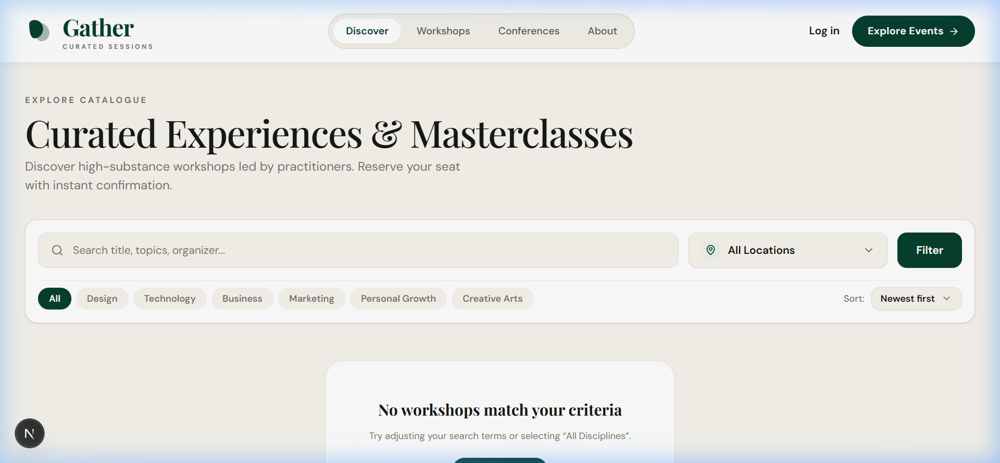
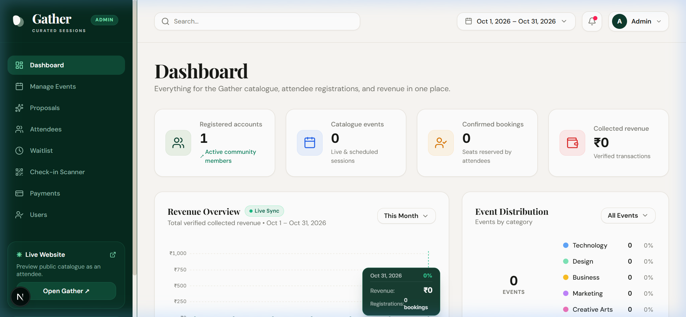
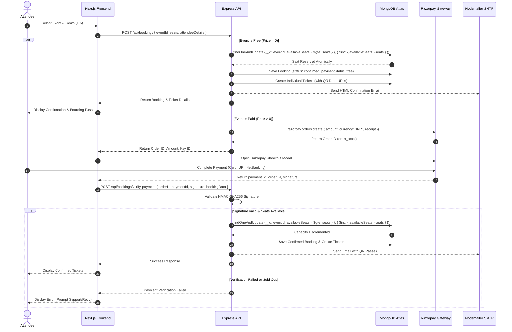
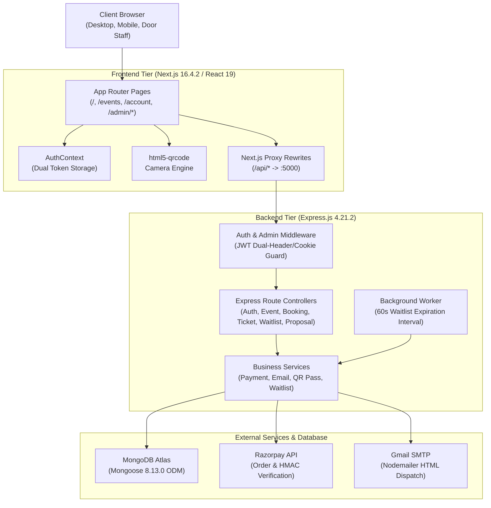

# Gather — Curated Event & Workshop Platform

> **Curated Event & Workshop Platform**  
> An editorial discovery, seat reservation, and event operations platform engineered with modern architectural rigor. Gather unifies workshop discovery, atomic seat reservation guards, Razorpay payment processing, deterministic QR admission passes, automated FIFO waitlist management, in-browser camera check-in scanning, and a curator proposal pipeline.

---

[](https://nodejs.org/)
[](https://nextjs.org/)
[](https://react.dev/)
[](https://expressjs.com/)
[](https://www.mongodb.com/)
[](https://tailwindcss.com/)
[](https://razorpay.com/)
[](https://github.com/RiyaRahees/Gather.git)

---

## Table of Contents

- [Overview](#overview)
- [Interface Preview](#interface-preview)
- [Key Features](#key-features)
  - [Attendee Experience](#attendee-experience)
  - [Administrator Operations](#administrator-operations)
- [Event Booking Lifecycle](#event-booking-lifecycle)
  - [Workflow Diagram](#workflow-diagram)
  - [Free Registration Mechanics](#free-registration-mechanics)
  - [Paid Razorpay Checkout & Verification](#paid-razorpay-checkout--verification)
  - [Concurrency & Atomic Seat Allocation](#concurrency--atomic-seat-allocation)
  - [Cancellations & Seat Recovery](#cancellations--seat-recovery)
- [System Architecture](#system-architecture)
  - [High-Level Architecture Diagram](#high-level-architecture-diagram)
  - [Subsystem Communication](#subsystem-communication)
- [Technology Stack](#technology-stack)
- [Project Directory Structure](#project-directory-structure)
- [Database Models](#database-models)
- [Environment Variables](#environment-variables)
  - [Backend Configuration (`backend/.env`)](#backend-configuration-backendenv)
  - [Frontend Configuration (`frontend/.env.local`)](#frontend-configuration-frontendenvlocal)
- [Installation & Local Setup](#installation--local-setup)
  - [Prerequisites](#prerequisites)
  - [Step 1: Install Dependencies](#step-1-install-dependencies)
  - [Step 2: Configure Environment Files](#step-2-configure-environment-files)
  - [Step 3: Seed Database Workshops](#step-3-seed-database-workshops)
  - [Step 4: Start Application](#step-4-start-application)
  - [Verification & Health Check](#verification--health-check)
- [Complete REST API Reference](#complete-rest-api-reference)
  - [Authentication API (`/api/auth`)](#authentication-api-apiauth)
  - [Events API (`/api/events`)](#events-api-apievents)
  - [Bookings API (`/api/bookings`)](#bookings-api-apibookings)
  - [Tickets & Door Check-In API (`/api/tickets`)](#tickets--door-check-in-api-apitickets)
  - [Waitlist API (`/api/waitlist`)](#waitlist-api-apiwaitlist)
  - [Curator Proposals API (`/api/proposals`)](#curator-proposals-api-apiproposals)
  - [Admin API (`/api/admin`)](#admin-api-apiadmin)
  - [Seed Utility API (`/api/seed`)](#seed-utility-api-apiseed)
- [Authentication & Security](#authentication--security)
  - [Dual-Token Isolation](#dual-token-isolation)
  - [Cryptographic Verification](#cryptographic-verification)
  - [Security Boundaries & Current Limitations](#security-boundaries--current-limitations)
- [Testing & Verification](#testing--verification)
- [Deployment Guide](#deployment-guide)
- [Troubleshooting](#troubleshooting)
- [Roadmap & License](#roadmap--license)

---

## Overview

**Gather** is a full-stack platform designed for the discovery, reservation, and on-site operation of curated in-person workshops, masterclasses, and creative studio sessions.

### Problem It Solves
Traditional ticketing software frequently suffers from generic styling, opaque overbooking risks during demand spikes, awkward QR code validation tools, and disconnected submission pipelines for prospective instructors. Gather solves these operational friction points through:
1. **Curated Editorial Aesthetic**: Warm natural paper palettes (`#FAF8F5`, `#F7F4ED`), deep botanical accents (`#073F2E`), and modern serif typography reflecting high-craft masterclasses.
2. **Deterministic Seat Protection**: MongoDB atomic capacity updates (`$inc` guarded with `$gte`) preventing double-allocation under concurrent checkouts.
3. **Automated Waitlist Recycling**: Background workers that monitor 2-hour seat claim windows and automatically promote the next waiting attendee if an offer expires.
4. **Zero-App Door Operations**: In-browser camera scanning powered by `html5-qrcode` to scan passes and execute check-ins without third-party mobile apps.
5. **Direct Curator Pipeline**: Public proposal intake connected to a 1-click administrative review and event creation modal.

### Target Personas
- **Attendees**: Creative professionals, engineers, and learners seeking studio workshops, reserving single or multi-seat passes, holding vector QR tickets, or joining priority waitlists.
- **Event Curators / Hosts**: Specialists submitting workshop pitches with customized curriculum plans and target formats.
- **Administrators & Door Staff**: Event organizers monitoring registrations, verifying transactions, executing ticket check-ins via camera or code, and managing event publications.

---

## Interface Preview

| Homepage & Editorial Hero | Workshop Catalogue & Filtering |
| :---: | :---: |
|  |  |

| Operational Admin Dashboard | Attendee Passes & Boarding Passes |
| :---: | :---: |
|  | Attendee passes with individual vector QR codes & print layouts |

---

## Key Features

### Attendee Experience
- **Editorial Discovery & Filtering**: Search masterclasses by keyword, discipline category (`Technology`, `Design`, `Business`, `Marketing`, `Personal Growth`, `Creative Arts`), venue city, or sort order (newest, price, seat availability).
- **Seat Availability Tracking**: Dynamic seat counter reflecting real-time remaining capacity (`"Only X seats remaining"` vs `"Sold Out — Join Waitlist"`).
- **Bifurcated Registration**: Instant zero-cost confirmation for free events, and Razorpay modal checkout for paid registrations.
- **Multi-Seat Bookings**: Support for reserving 1 to 5 seats in a single checkout, generating individual sequential passes (`-S01`, `-S02`, etc.).
- **Digital Passes & Vector QR Codes**: Attendee portal displaying interactive boarding pass modals with high-contrast QR codes and one-click print styling.
- **Self-Service Cancellations**: Full cancellation workflow from the attendee account dashboard or via direct secure cryptographic links sent via email.
- **Automated Waitlist Participation**: Queue joining on sold-out events with automated 2-hour offer claims when cancellations occur.
- **Password Reset Pipeline**: Multi-step password recovery flow with 6-digit OTP codes and reset tokens dispatched via email.

### Administrator Operations
- **Executive Analytics Dashboard**: Operational overview displaying total published events, confirmed bookings, aggregate revenue, active waitlist count, and category breakdown.
- **Workshop CRUD & Image Presets**: Form interface to publish, modify, unpublish, and delete events with curated photographic preset selectors.
- **Master Registration Registry**: Searchable directory of all attendee bookings filterable by event, status, or search query (name, email, reference code).
- **Payments Ledger**: Dedicated audit table displaying Razorpay order identifiers, payment IDs, transaction dates, and settlement amounts.
- **Curator Proposal Review**: Pitch pipeline tracking status (`pending`, `approved`, `rejected`) with administrative review notes and a 1-click **"Create Event from Proposal"** action that pre-populates event forms.
- **Hardware-Free QR Door Check-In**: Browser-based camera scanner running `html5-qrcode` for front/rear camera pass scanning, duplicate check-in detection, and manual code lookup with audio tones.
- **Waitlist Control**: Monitor waitlist positions across events, manually promote waiting users, or remove expired entries.
- **User Account Directory**: Master directory of registered attendees and administrators.

---

## Event Booking Lifecycle

### Workflow Diagram



### Free Registration Mechanics
For workshops with `price: 0`, the client initiates `POST /api/bookings`. The server confirms authentication, verifies that `seats` does not exceed the remaining capacity, executes an atomic decrement on `Event.availableSeats`, persists a `confirmed` booking record with `paymentStatus: "free"`, generates the corresponding `Ticket` records with vector QR code Data URLs, and triggers an automated confirmation email.

### Paid Razorpay Checkout & Verification
For paid workshops, a two-phase protocol is enforced:
1. **Order Initiation**: The backend invokes `razorpay.orders.create` with the calculated amount in Indian Paise (`amount * 100`). The created order ID is returned to the client without decrementing event capacity prematurely.
2. **Cryptographic Verification**: Once the attendee finishes checkout in Razorpay's modal, the client receives `razorpay_order_id`, `razorpay_payment_id`, and `razorpay_signature`. These are submitted to `/api/bookings/verify-payment`. The backend computes:
   ```javascript
   const expectedSignature = crypto
     .createHmac("sha256", process.env.RAZORPAY_KEY_SECRET)
     .update(`${razorpayOrderId}|${razorpayPaymentId}`)
     .digest("hex");
   ```
   If and only if `expectedSignature === razorpaySignature`, the backend attempts the atomic seat reservation. If seats are secured, the booking and tickets are created.

### Concurrency & Atomic Seat Allocation
To eliminate race conditions and overselling, seat allocation uses MongoDB's atomic document update operators:
```javascript
const updatedEvent = await Event.findOneAndUpdate(
  { _id: eventId, availableSeats: { $gte: seats } },
  { $inc: { availableSeats: -seats } },
  { new: true }
);
```
If two attendees attempt to reserve the final remaining seat simultaneously, exactly one query satisfies `{ availableSeats: { $gte: seats } }`. The subsequent query returns `null`, causing the backend to fail the transaction safely and prevent overbooking.

### Cancellations & Seat Recovery
When a booking is cancelled (either through the `/account` dashboard or via `/bookings/cancel?id=...&token=...`):
1. The booking status transitions to `cancelled`.
2. All associated `Ticket` documents transition to `cancelled`.
3. If an active FIFO queue exists in the `Waitlist` collection:
   - The earliest `WAITING` candidate is marked `OFFERED`.
   - An expiration timestamp is set: `offerExpiresAt = Date.now() + 2 * 60 * 60 * 1000` (2 hours).
   - An alert email is dispatched offering them the newly available seat.
4. If no waitlist candidates exist, the seats are returned to `Event.availableSeats` via an atomic `$inc`.
5. A 60-second background worker running in `server.js` polls for expired offers (`offerExpiresAt < Date.now()`), marks them `EXPIRED`, and advances the offer to the next in line.

---

## System Architecture

### High-Level Architecture Diagram



### Subsystem Communication
- **Client to Frontend**: Next.js App Router renders modern React 19 components styled with Tailwind CSS v4.
- **Frontend to Backend**: API requests are dispatched to `/api/*`, which are forwarded by Next.js rewrites (`next.config.mjs`) to the Node.js Express server on `http://127.0.0.1:5000`.
- **Backend to Database**: Express communicates with MongoDB Atlas via Mongoose 8.13.0 connection pooling with auto-reconnect logic.
- **Payment Gateway**: Orders are requested securely using server-side Razorpay credentials; client renders payment frames and returns signed payload for HMAC SHA-256 verification.
- **Notification Services**: Transactional booking confirmations and waitlist notifications are formatted using responsive HTML templates and dispatched through Nodemailer over Gmail SMTP.

---

## Technology Stack

| Layer | Technology | Actual Version | Architectural Role |
| :--- | :--- | :--- | :--- |
| **Frontend Framework** | Next.js | `16.4.2` | App Router, server-rendered layouts, dynamic client pages, and reverse-proxy rewrites |
| **UI Library** | React / React DOM | `19.3.0` | Declarative component tree, stateful modal handling, interactive event discovery |
| **Styling Engine** | Tailwind CSS / PostCSS | `4.0.0` / `8.5.0` | Custom design tokens, warm paper palettes, responsive grid systems |
| **Icons** | Lucide React | `1.60.0` | Consistent iconography across navigation, status indicators, and administrative actions |
| **QR Code Scanner** | `html5-qrcode` | `2.3.8` | In-browser camera video stream decoder for door admission scanning |
| **QR Code Generator** | `qrcode` | `1.5.4` | Server-rendered base64 data URLs and vector SVG rendering for ticket boarding passes |
| **Backend Runtime** | Node.js | `>= 18.0.0` | ES Module runtime environment (`"type": "module"`) |
| **API Framework** | Express.js | `4.21.2` | RESTful routing, middleware chains, cookie parsing, and request handling |
| **Database Engine** | MongoDB Atlas | Cluster 8.x | Distributed cloud NoSQL database storing users, workshops, passes, and logs |
| **Database ODM** | Mongoose | `8.13.0` | Schema definitions, validation rules, index management, and atomic queries |
| **Authentication** | `jsonwebtoken` | `9.0.3` | Cryptographic JWT generation, role assertion, and verification |
| **Password Hashing** | `bcryptjs` | `3.0.3` | Secure password salt generation and hashing (12 rounds) |
| **Payment Gateway** | Razorpay Node SDK | `2.9.6` | Server-side order creation and cryptographic checkout verification |
| **Email Dispatcher** | Nodemailer | `6.10.0` | SMTP client dispatching HTML booking confirmations and waitlist notifications |
| **CORS Middleware** | `cors` | `2.8.5` | Cross-Origin Resource Sharing control with configurable frontend whitelist |
| **Cookie Middleware**| `cookie-parser`| `1.4.7` | HTTP-only cookie parsing for session tokens |

---

## Project Directory Structure

```text
gather/
├── package.json                         # Workspace scripts for frontend, backend, and seeding
├── .gitignore                           # Repository ignore rules (node_modules, .env, .next)
├── screenshots/                         # Actual user interface previews
│   ├── homepage.png                     # Editorial homepage and category grids
│   ├── events_catalogue.png             # Workshop catalogue and filters
│   └── admin_dashboard.png              # Administrative metrics and revenue tracking
├── backend/
│   ├── package.json                     # Backend dependencies and execution scripts
│   ├── server.js                        # Express server, middleware mounting, and 60s waitlist worker
│   ├── .env                             # Active environment variables (git-ignored)
│   ├── .env.example                     # Reference template for backend configuration
│   ├── config/
│   │   └── db.js                        # Resilient MongoDB Atlas Mongoose connection pool
│   ├── controllers/
│   │   ├── adminController.js           # Analytics statistics, bookings master list, payments ledger
│   │   ├── authController.js            # User/Admin registration, login, logout, password reset, OAuth
│   │   ├── bookingController.js         # Booking reservation, Razorpay verification, cancellations
│   │   ├── eventController.js           # Workshop discovery, filtering, search, and admin CRUD
│   │   ├── proposalController.js        # Curator pitches submission, administrative review, deletion
│   │   ├── seedController.js            # API database seed controller
│   │   ├── ticketController.js          # Pass retrieval, vector QR codes, admin verification & check-in
│   │   └── waitlistController.js        # Priority queue registration, offer claims, and queue management
│   ├── middleware/
│   │   ├── adminMiddleware.js           # Strict role="admin" authorization gatekeeper
│   │   ├── authMiddleware.js            # Dual-source JWT verification (x-user-token / x-admin-token / cookies)
│   │   └── errorHandler.js              # Centralized JSON error serialization
│   ├── models/
│   │   ├── Booking.js                   # Reservation records, payment references, cancellation tokens
│   │   ├── Event.js                     # Workshop schema, capacity counters, pricing, and category enums
│   │   ├── Proposal.js                  # Public curator pitch submissions, status, and curator reviews
│   │   ├── Ticket.js                    # Individual pass records, deterministic ticket codes, scan status
│   │   ├── User.js                      # Attendee and administrator accounts, password hashes, roles
│   │   └── Waitlist.js                  # FIFO queue entries, status lifecycle, and 2-hour offer timestamps
│   ├── routes/
│   │   ├── adminRoutes.js               # /api/admin endpoints (dashboard stats, registry, payments)
│   │   ├── authRoutes.js                # /api/auth endpoints (register, login, me, reset-password)
│   │   ├── bookingRoutes.js             # /api/bookings endpoints (create, verify-payment, my, cancel)
│   │   ├── eventRoutes.js               # /api/events endpoints (public catalogue and admin CRUD)
│   │   ├── proposalRoutes.js            # /api/proposals endpoints (host submissions and review)
│   │   ├── seedRoutes.js                # /api/seed utility endpoints
│   │   ├── ticketRoutes.js              # /api/tickets endpoints (user passes and door check-in)
│   │   └── waitlistRoutes.js            # /api/waitlist endpoints (join, claim, admin promote)
│   ├── scripts/
│   │   ├── inspectDb.js                 # Database diagnostics and collection inspector
│   │   ├── seed.js                      # Standard initial workshop seeder
│   │   └── seedActualWorkshops.js       # Production masterclass seeder across all 6 disciplines
│   ├── services/
│   │   ├── emailService.js              # Nodemailer HTML template engine and SMTP transport
│   │   ├── paymentService.js            # Razorpay SDK wrapper and HMAC signature verification
│   │   ├── ticketService.js             # Pass issuance, QR generation, and check-in mutator
│   │   └── waitlistService.js           # Queue promotion logic and 60-second expiration scheduler
│   └── utils/
│       ├── jwt.js                       # JWT sign and verification utilities
│       ├── memoryStore.js               # In-memory fallback data cache
│       └── password.js                  # Bcrypt hashing and password comparison helpers
│
└── frontend/
    ├── package.json                     # Frontend dependencies and Next.js scripts
    ├── next.config.mjs                  # Turbopack options and Next.js API proxy rewrites to :5000
    ├── postcss.config.mjs               # PostCSS configuration for Tailwind CSS v4
    ├── .env.local                       # Local frontend environment variables (git-ignored)
    ├── .env.example                     # Reference template for frontend configuration
    ├── public/
    │   └── images/                      # Curated high-resolution workshop photographic assets
    └── src/
        ├── app/
        │   ├── layout.jsx               # Root HTML layout, Newsreader & Inter typography, Razorpay script
        │   ├── page.jsx                 # Editorial homepage, hero showcase, curated discipline grids
        │   ├── account/
        │   │   ├── page.jsx             # User account dashboard, active ticket summary, quick links
        │   │   └── bookings/page.jsx    # Expanded attendee passes view with cancellations & waitlist
        │   ├── admin/
        │   │   ├── layout.jsx           # Administrative shell with persistent sidebar and session guard
        │   │   ├── dashboard/page.jsx   # Metrics overview, revenue cards, recent registration table
        │   │   ├── events/page.jsx      # Workshop management, seat counters, image preset selector
        │   │   ├── bookings/page.jsx    # Attendee registry with search, status filters, and pass inspectors
        │   │   ├── payments/page.jsx    # Financial transaction ledger and Razorpay payment audit
        │   │   ├── proposals/page.jsx   # Pitch submission queue with 1-click event creation modal
        │   │   ├── check-in/page.jsx    # Camera-based live QR ticket scanner and manual code entry
        │   │   ├── waitlist/page.jsx    # Workshop waitlist queue monitor with manual promote actions
        │   │   ├── users/page.jsx       # Registered user accounts directory
        │   │   └── login/page.jsx       # Dedicated admin portal login interface
        │   ├── bookings/
        │   │   └── cancel/page.jsx      # Public secure cancellation page accessed via email token
        │   ├── events/
        │   │   ├── page.jsx             # Workshop catalogue with category filters, search, and sorting
        │   │   └── [id]/page.jsx        # Workshop detail page, seat picker, Razorpay checkout trigger
        │   ├── host/page.jsx            # Public curator pitch submission form with syllabus builder
        │   ├── login/page.jsx           # Attendee login interface with autofill prevention
        │   └── register/page.jsx        # Attendee registration form
        ├── components/
        │   ├── admin/
        │   │   └── AdminSidebar.jsx     # Administrative navigation sidebar with active route highlights
        │   ├── auth/
        │   │   └── UnifiedAuthCard.jsx  # Dual sign-in/register card with browser autofill guards
        │   ├── common/
        │   │   ├── ConfirmDialog.jsx    # Reusable modal dialog for cancellation and deletion prompts
        │   │   ├── GoogleSignInButton.jsx # Google OAuth authentication component
        │   │   ├── Logo.jsx             # Gather brand mark and typography
        │   │   └── PriceTag.jsx         # Currency formatter utility component
        │   ├── layout/
        │   │   ├── Footer.jsx           # Editorial site footer with platform navigation
        │   │   └── Navbar.jsx           # Header navigation with responsive menu and profile links
        │   └── tickets/
        │       └── TicketModal.jsx      # Boarding pass modal with vector QR code and print layout
        ├── context/
        │   └── AuthContext.jsx          # Universal session state, role validation, and token manager
        └── lib/
            └── api.js                   # Universal API client and backend URL resolver
```

---

## Database Models

The MongoDB database contains 6 primary Mongoose collections:

### 1. `Event` (`models/Event.js`)
Represents an individual workshop or masterclass.
- `title` (*String, required, max 150*): Workshop title.
- `slug` (*String, unique*): URL-friendly slug generated from title.
- `description` (*String, required*): Syllabus, materials, and learning outcomes.
- `category` (*String, enum*): `Technology`, `Design`, `Business`, `Marketing`, `Personal Growth`, `Creative Arts`.
- `image` (*String*): Path to photographic image (e.g. `/images/ceramics.jpg`).
- `date` (*String*): Display date string (e.g. `Nov 14, 2026`).
- `time` (*String*): Session schedule (e.g. `10:00 AM - 4:30 PM IST`).
- `venue` (*String*): Physical location or studio address.
- `price` (*Number, default: 0*): Price per seat in INR (`0` designates free event).
- `currency` (*String, default: "₹"*): Display currency symbol.
- `totalSeats` (*Number, required*): Maximum seating capacity.
- `availableSeats` (*Number, required*): Remaining bookable seats; decremented atomically.
- `organizerName` (*String*): Instructor or studio name.
- `isPublished` (*Boolean, default: true*): Controls public visibility in event catalogue.
- `isFeatured` (*Boolean, default: false*): Controls promotion on homepage showcase.
- `createdBy` (*ObjectId, ref: "User"*): Administrator who created the event.

### 2. `Booking` (`models/Booking.js`)
Tracks attendee reservations and payment transactions.
- `bookingRef` (*String, unique, indexed*): Generated reference code (e.g., `EF-MVKM0GZB-GLI7`).
- `user` (*ObjectId, ref: "User", required*): Purchasing user account.
- `event` (*ObjectId, ref: "Event", required*): Workshop associated with booking.
- `seatsBooked` (*Number, required, min: 1, max: 5*): Number of reserved seats.
- `attendeeName` (*String, required*): Full name of primary attendee.
- `attendeeEmail` (*String, required*): Contact email for ticket delivery.
- `attendeePhone` (*String*): Contact phone number.
- `amount` (*Number, required*): Total transaction value in INR.
- `bookingStatus` (*String, enum: "confirmed", "cancelled", "pending"*): Booking state.
- `paymentStatus` (*String, enum: "completed", "free", "pending", "failed"*): Payment status.
- `razorpayOrderId` (*String*): Order identifier generated by Razorpay.
- `razorpayPaymentId` (*String*): Successful payment ID from Razorpay.
- `razorpaySignature` (*String*): HMAC SHA256 signature verified by backend.
- `cancellationSecret` (*String, indexed*): Cryptographic token for unauthenticated 1-click email cancellation.
- `cancelledAt` (*Date*): Cancellation timestamp.

### 3. `Ticket` (`models/Ticket.js`)
Represents an individual seat admission pass.
- `ticketCode` (*String, unique, indexed*): Unique pass code (e.g., `EF-MVKM0GZB-GLI7-S01`).
- `booking` (*ObjectId, ref: "Booking", required*): Parent reservation.
- `event` (*ObjectId, ref: "Event", required*): Associated workshop.
- `user` (*ObjectId, ref: "User", required*): Ticket owner.
- `attendeeName` (*String, required*): Name printed on ticket.
- `attendeeEmail` (*String, required*): Email address for delivery.
- `seatNumber` (*Number, required*): Ordinal seat position within booking.
- `qrCodeDataUrl` (*String*): Base64 Data URL containing the encoded ticket string.
- `status` (*String, enum: "valid", "checked_in", "cancelled", default: "valid"*): Pass state.
- `checkedInAt` (*Date*): Door check-in timestamp.
- `checkedInBy` (*ObjectId, ref: "User"*): Administrator staff member who scanned pass.

### 4. `Waitlist` (`models/Waitlist.js`)
Manages queue priority for sold-out events.
- `event` (*ObjectId, ref: "Event", required*): Sold-out workshop.
- `user` (*ObjectId, ref: "User", required*): Waitlisted attendee.
- `name` (*String, required*): Full name.
- `email` (*String, required*): Notification email address.
- `seatsRequested` (*Number, default: 1*): Seats required.
- `status` (*String, enum: "WAITING", "OFFERED", "ACCEPTED", "EXPIRED", "CANCELLED"*): Queue status.
- `queuePosition` (*Number*): Numerical rank in queue.
- `offeredAt` (*Date*): Timestamp when a seat was offered.
- `offerExpiresAt` (*Date*): Cutoff timestamp (offeredAt + 2 hours).

### 5. `Proposal` (`models/Proposal.js`)
Curator pitch submissions received via `/host`.
- `hostName` (*String, required*): Pitching instructor's name.
- `hostEmail` (*String, required*): Contact email.
- `hostPhone` (*String*): Phone number.
- `title` (*String, required*): Proposed workshop title.
- `category` (*String, enum: 6 categories*): Workshop discipline.
- `city` (*String, required*): Target city/location.
- `format` (*String, required*): Format (e.g. `Studio Workshop`, `Masterclass`).
- `targetPrice` (*Number, default: 0*): Suggested attendee ticket price.
- `description` (*String, required*): Detailed curriculum syllabus and objectives.
- `status` (*String, enum: "pending", "approved", "rejected", default: "pending"*): Pitch status.
- `adminNotes` (*String*): Internal curator feedback and review notes.

### 6. `User` (`models/User.js`)
Platform accounts and authentication credentials.
- `name` (*String, required*): Full user name.
- `email` (*String, required, unique, lowercase*): Login email.
- `passwordHash` (*String, select: false*): Bcrypt hash (12 salt rounds).
- `role` (*String, enum: "user", "admin", default: "user"*): Access role.
- `googleId` (*String*): Google OAuth identifier if linked.
- `resetOtp` (*String, select: false*): 6-digit password recovery code.
- `resetOtpExpires` (*Date, select: false*): OTP expiration timestamp.

---

## Environment Variables

### Backend Configuration (`backend/.env`)

| Variable | Required | Description | Example / Placeholder |
| :--- | :---: | :--- | :--- |
| `PORT` | Optional | Express server listening port (defaults to `5000`) | `5000` |
| `MONGODB_URI` | **Yes** | MongoDB Atlas connection string | `mongodb+srv://<username>:<password>@<cluster>.mongodb.net/gather?retryWrites=true&w=majority` |
| `JWT_SECRET` | **Yes** | Secret key used to sign and verify JWT authentication tokens | `your_secure_32_character_jwt_secret_key` |
| `FRONTEND_URL` | **Yes** | Allowed origin URL for CORS policy | `http://localhost:3000` |
| `RAZORPAY_KEY_ID` | Optional* | Razorpay test Key ID (*required for paid checkouts) | `rzp_test_your_key_id` |
| `RAZORPAY_KEY_SECRET` | Optional* | Razorpay test Key Secret (*required for paid signature verification) | `your_razorpay_secret_key` |
| `SMTP_HOST` | Optional | SMTP host for email delivery (defaults to `smtp.gmail.com`) | `smtp.gmail.com` |
| `SMTP_PORT` | Optional | SMTP port (defaults to `587`) | `587` |
| `SMTP_USER` | Optional | Email account for transactional notifications | `your_email@gmail.com` |
| `SMTP_PASS` | Optional | 16-character Google App Password (not your personal password) | `abcd efgh ijkl mnop` |
| `EMAIL_FROM` | Optional | Display name and sender address for outgoing emails | `Gather <noreply@gather.dev>` |
| `NODE_ENV` | Optional | Environment mode (`development` or `production`) | `development` |

### Frontend Configuration (`frontend/.env.local`)

| Variable | Required | Description | Example / Placeholder |
| :--- | :---: | :--- | :--- |
| `NEXT_PUBLIC_API_URL` | **Yes** | Base URL for backend Express REST API | `http://127.0.0.1:5000/api` |
| `NEXT_PUBLIC_RAZORPAY_KEY_ID` | Optional* | Public Razorpay Key ID used by client checkout modal | `rzp_test_your_key_id` |
| `NEXT_PUBLIC_GOOGLE_CLIENT_ID`| Optional | Google OAuth Web Client ID for Google Sign-In | `your_google_client_id.apps.googleusercontent.com` |

---

## Installation & Local Setup

### Prerequisites
- **Node.js**: `v18.0.0` or higher (verified with Node.js 18+ and 20+)
- **npm**: `v9.0.0` or higher
- **MongoDB**: Access to an active MongoDB Atlas cluster (or local MongoDB 6+)
- **Razorpay Account**: Free test API credentials from [Razorpay Dashboard](https://dashboard.razorpay.com) (for paid transactions)

### Step 1: Clone Repository
```bash
git clone https://github.com/RiyaRahees/Gather.git
cd Gather
```

### Step 2: Install Dependencies
Open a terminal in the project directory:

```bash
# Install backend dependencies
cd backend
npm install

# Install frontend dependencies
cd ../frontend
npm install
```

### Step 3: Configure Environment Files
1. In `backend/`, copy the example template to create your `.env` file:
   ```bash
   cp .env.example .env
   ```
   Populate `MONGODB_URI`, `JWT_SECRET`, and your Razorpay credentials.

2. In `frontend/`, copy the example template to create `.env.local`:
   ```bash
   cp .env.example .env.local
   ```
   Ensure `NEXT_PUBLIC_API_URL` points to `http://127.0.0.1:5000/api`.

### Step 4: Seed Database Workshops
Populate your database with the complete suite of curated workshops across all 6 disciplines:
```bash
cd ../backend
node scripts/seedActualWorkshops.js
```
*(This initializes masterclasses in Typography, Coffee Roasting, Sourdough, Ceramic Wheel Throwing, Machine Learning, and Architecture, while creating the default administrator user: `admin@gmail.com`)*.

### Step 5: Start Application

**Option A — Running Concurrently from Workspace Root:**
```bash
# Terminal 1: Run Backend API (Port 5000)
npm run dev:backend

# Terminal 2: Run Next.js Frontend (Port 3000)
npm run dev:frontend
```

**Option B — Running from Subdirectories:**
```bash
# Terminal 1: Backend
cd backend
npm run dev

# Terminal 2: Frontend
cd frontend
npm run dev
```

### Verification & Health Check
Verify the running services in your browser or terminal:
- **Frontend Application**: [http://localhost:3000](http://localhost:3000)
- **Backend API Root**: [http://localhost:5000](http://localhost:5000)
- **Backend Health Check**: [http://localhost:5000/api/health](http://localhost:5000/api/health)
  ```json
  {
    "status": "healthy",
    "service": "EventFlow API",
    "timestamp": "2026-10-23T06:37:30.500Z",
    "database": {
      "connected": true,
      "state": "connected"
    }
  }
  ```

---

## Complete REST API Reference

All responses return standard JSON. Authenticated endpoints accept tokens via cookies (`usertoken` or `admintoken`), custom headers (`x-user-token`, `x-admin-token`), or standard `Authorization: Bearer <token>`.

### Authentication API (`/api/auth`)

| Method | Endpoint | Access Level | Description | Key Request / Response Details |
| :--- | :--- | :--- | :--- | :--- |
| `POST` | `/api/auth/register` | Public | Register new attendee account | Body: `{ name, email, password }` |
| `POST` | `/api/auth/login` | Public | Attendee sign in | Rejects accounts with `role="admin"`. Returns JWT token and sets `usertoken` cookie |
| `POST` | `/api/auth/admin-login`| Public | Admin portal sign in | Strictly requires `role="admin"`. Sets `admintoken` cookie |
| `POST` | `/api/auth/google` | Public | Authenticate via Google OAuth token | Body: `{ token: "<google_credential>" }` |
| `GET` | `/api/auth/me` | Protected | Fetch current session profile | Returns `{ user: { id, name, email, role } }` |
| `POST` | `/api/auth/forgot-password` | Public | Request 6-digit password reset OTP | Body: `{ email }`. Dispatches email with reset code |
| `POST` | `/api/auth/reset-password` | Public | Reset password using OTP | Body: `{ email, otp, newPassword }` |
| `POST` | `/api/auth/logout` | Public | Terminate active session | Clears `usertoken`, `admintoken`, and `auth_token` cookies |

### Events API (`/api/events`)

| Method | Endpoint | Access Level | Description | Key Request / Response Details |
| :--- | :--- | :--- | :--- | :--- |
| `GET` | `/api/events` | Public | List published workshops | Query: `?category=Design&search=ceramic&city=Kochi&sort=price-asc` |
| `GET` | `/api/events/:id` | Public | Retrieve workshop details | Parameter can be either MongoDB `_id` or unique `slug` |
| `POST` | `/api/events` | Admin Only | Publish a new workshop | Body: `{ title, description, category, price, totalSeats, venue, date, time, image }` |
| `PUT` | `/api/events/:id` | Admin Only | Modify existing workshop | Body: partial event fields to update |
| `DELETE`| `/api/events/:id` | Admin Only | Delete a workshop | Returns `{ message: "Event removed successfully" }` |

### Bookings API (`/api/bookings`)

| Method | Endpoint | Access Level | Description | Key Request / Response Details |
| :--- | :--- | :--- | :--- | :--- |
| `POST` | `/api/bookings` | Protected (User) | Initiate booking or create Razorpay order | Body: `{ eventId, seats, attendeeName, attendeeEmail, attendeePhone }` |
| `POST` | `/api/bookings/verify-payment` | Protected (User) | Verify Razorpay HMAC signature & issue passes | Body: `{ razorpayOrderId, razorpayPaymentId, razorpaySignature, bookingData }` |
| `GET` | `/api/bookings/my` | Protected (User) | List authenticated user's bookings | Populates associated `event` and `tickets` |
| `POST` | `/api/bookings/:id/cancel` | Protected (User) | Self-service cancellation from account | Restores seats or triggers waitlist offer |
| `GET` | `/api/bookings/cancel-info` | Public | Preview cancellation details via email token | Query: `?id=<bookingId>&token=<cancellationSecret>` |
| `POST` | `/api/bookings/cancel-by-token`| Public | Confirm cancellation via email token | Body: `{ bookingId, token }`. No login required |

### Tickets & Door Check-In API (`/api/tickets`)

| Method | Endpoint | Access Level | Description | Key Request / Response Details |
| :--- | :--- | :--- | :--- | :--- |
| `GET` | `/api/tickets/my` | Protected (User) | List all tickets belonging to user | Returns array of `Ticket` objects |
| `GET` | `/api/tickets/booking/:bookingId` | Protected (User) | List tickets for a specific booking | Includes vector base64 QR Code Data URLs |
| `GET` | `/api/tickets/:id` | Protected (User) | Fetch single ticket by ID | Returns ticket metadata and check-in status |
| `POST` | `/api/tickets/admin/verify` | Admin Only | Validate ticket string from camera scanner | Body: `{ code: "EF-XXXX-S01" }`. Checks duplicate scans |
| `POST` | `/api/tickets/admin/check-in` | Admin Only | Execute door admission check-in | Body: `{ ticketId }` or `{ code }`. Sets `status: "checked_in"` |

### Waitlist API (`/api/waitlist`)

| Method | Endpoint | Access Level | Description | Key Request / Response Details |
| :--- | :--- | :--- | :--- | :--- |
| `POST` | `/api/waitlist/join` | Protected (User) | Join priority waitlist for sold-out event | Body: `{ eventId, seatsRequested, name, email }` |
| `GET` | `/api/waitlist/my` | Protected (User) | Retrieve user's active waitlist entries | Includes current queue position and offer expiry |
| `GET` | `/api/waitlist/event/:eventId` | Public / Optional | Fetch waitlist metrics for an event | Returns count of active waiting candidates |
| `POST` | `/api/waitlist/:id/leave` | Protected (User) | Leave waitlist queue | Marks record `status: "CANCELLED"` |
| `POST` | `/api/waitlist/claim/free` | Protected (User) | Claim an offered seat for a free event | Confirms booking and generates passes |
| `POST` | `/api/waitlist/claim/initiate-paid` | Protected (User) | Create Razorpay order to claim offered seat | Returns Razorpay Order ID for checkout |
| `POST` | `/api/waitlist/claim/verify-paid` | Protected (User) | Verify Razorpay payment and claim offered seat | Validates HMAC signature and issues passes |
| `GET` | `/api/waitlist/admin` | Admin Only | View full waitlist registry across events | Returns all waiting and offered entries |
| `DELETE`| `/api/waitlist/admin/:id` | Admin Only | Remove an attendee from waitlist | Marks entry `CANCELLED` |
| `POST` | `/api/waitlist/admin/:id/promote` | Admin Only | Manually offer seat to specific waitlist entry | Sets `OFFERED` status with 2-hour window |

### Curator Proposals API (`/api/proposals`)

| Method | Endpoint | Access Level | Description | Key Request / Response Details |
| :--- | :--- | :--- | :--- | :--- |
| `POST` | `/api/proposals` | Public | Submit workshop proposal from `/host` | Body: `{ hostName, hostEmail, title, category, city, format, targetPrice, description }` |
| `GET` | `/api/proposals/admin` | Admin Only | List all submitted curator proposals | Query: `?status=pending&search=design` |
| `PATCH`| `/api/proposals/admin/:id/status`| Admin Only | Update proposal review status & notes | Body: `{ status: "approved" \| "rejected", adminNotes: "..." }` |
| `DELETE`| `/api/proposals/admin/:id` | Admin Only | Delete proposal pitch from database | Returns confirmation message |

### Admin API (`/api/admin`)

| Method | Endpoint | Access Level | Description | Key Request / Response Details |
| :--- | :--- | :--- | :--- | :--- |
| `GET` | `/api/admin/dashboard` | Admin Only | Fetch consolidated platform metrics | Total revenue, bookings, events, waitlists, category counts |
| `GET` | `/api/admin/stats` | Admin Only | Alias for `/api/admin/dashboard` | Returns platform summary metrics |
| `GET` | `/api/admin/bookings` | Admin Only | Attendee master registry | Search by name/email/bookingRef with status filters |
| `GET` | `/api/admin/payments` | Admin Only | Audit log of completed Razorpay payments | Returns transaction IDs, amounts, dates, and order IDs |
| `GET` | `/api/admin/events` | Admin Only | Catalogue of all workshops including drafts | Returns both published and unpublished workshops |
| `GET` | `/api/admin/users` | Admin Only | Directory of registered user accounts | Returns user profiles and assigned roles |

### Seed Utility API (`/api/seed`)

| Method | Endpoint | Access Level | Description | Key Request / Response Details |
| :--- | :--- | :--- | :--- | :--- |
| `GET` / `POST` | `/api/seed` | Public / Dev | Reset and re-seed database with default events | Intended for development and initial provisioning |

---

## Authentication & Security

### Dual-Token Isolation
To avoid privilege leakage between regular workshop attendees and administrators:
- **Attendees** receive a session token identifying them as `role: "user"`, stored in the `usertoken` cookie and returned in response payloads.
- **Administrators** authenticate through a dedicated portal (`/admin/login`) hitting `/api/auth/admin-login`. The server verifies that the database record has `role === "admin"`. On success, an isolated `admintoken` cookie is issued.
- **Middleware Guard**: `requireAuth` validates the token from cookies or headers (`x-user-token` / `x-admin-token`), while `requireAdmin` explicitly asserts `req.user.role === "admin"`. If an attendee presents a valid user token to an administrative route, access is rejected with `403 Forbidden`.

### Cryptographic Verification
- **Passwords**: Hashed with `bcryptjs` using 12 salt rounds before storage.
- **Razorpay Payments**: Every completed payment signature is validated using `crypto.createHmac("sha256", RAZORPAY_KEY_SECRET)` over `${orderId}|${paymentId}`. Client-side claims of payment completion are never trusted without this server-side signature match.
- **Cancellations**: Cancellation links sent in transactional confirmation emails utilize a randomly generated 64-character hexadecimal `cancellationSecret`. This allows an attendee to cancel their booking from their email client without exposing credentials or requiring session login.

### Security Boundaries & Current Limitations
- **JWT Invalidation**: Token logout operates by instructing the client to clear stored cookies and local storage tokens. There is currently no persistent database token blacklist for instant server-side revocation prior to token expiration.
- **Camera Check-In Permissions**: In-browser QR scanning via `html5-qrcode` requires a secure context (`https://` or `localhost`). When hosting in staging or production environments, an SSL/TLS certificate is mandatory for camera hardware access.
- **Autofill Prevention**: Authentication forms use non-standard input naming and decoy fields (`data-lpignore="true"`, `autoComplete="new-password"`) to prevent browser password managers from auto-populating saved administrative passwords on public forms.

---

## Testing & Verification

### Current Test Status
- **Automated Tests**: This repository does not currently include an automated unit or end-to-end test framework (e.g., Jest, Vitest, Cypress, or Playwright).
- **Diagnostics & Manual Verification**:
  - The health check endpoint `GET /api/health` validates database connectivity and server uptime.
  - The database diagnostic script `node backend/scripts/inspectDb.js` inspects document counts across all 6 collections.
  - End-to-end checkout and door scanning workflows have been verified via browser testing across Chrome and mobile viewports.

### Recommended Future Test Suite
To elevate Gather to production enterprise standards, the following automated testing setup is recommended:
1. **API Integration Tests**: Supertest + Jest/Vitest for Express route coverage (verifying atomic seat decrements, role access rejection, and HMAC signature validation).
2. **Database Mocking**: In-memory MongoDB (`mongodb-memory-server`) to test concurrent checkout race conditions without connecting to MongoDB Atlas.
3. **E2E Browser Tests**: Playwright scripts testing the entire path from workshop selection to Razorpay modal mocking, ticket generation, and QR scan check-in.

---

## Deployment Guide

Gather uses a decoupled architecture. The frontend and backend can be hosted on separate cloud platforms:

### Frontend Deployment (e.g., Vercel)
1. Link your repository to [Vercel](https://vercel.com).
2. Set the **Root Directory** to `frontend`.
3. Configure the **Build Command** to `next build` and **Output Directory** to `.next`.
4. Configure Environment Variables in the Vercel dashboard:
   - `NEXT_PUBLIC_API_URL`: Your production backend URL (e.g. `https://api.yourdomain.com/api`).
   - `NEXT_PUBLIC_RAZORPAY_KEY_ID`: Your production or test Razorpay Key ID.
   - `NEXT_PUBLIC_GOOGLE_CLIENT_ID`: (Optional) Your Google OAuth Client ID.

### Backend Deployment (e.g., Render / Railway / Fly.io)
1. Create a Web Service pointing to `backend`.
2. Set **Build Command** to `npm install` and **Start Command** to `node server.js`.
3. Configure Environment Variables in the cloud dashboard:
   - `PORT`: Assigned automatically by cloud host (or `5000`).
   - `MONGODB_URI`: Production MongoDB Atlas connection URI.
   - `JWT_SECRET`: High-entropy 64+ character random string.
   - `FRONTEND_URL`: Production frontend URL (e.g. `https://gather.yourdomain.com`).
   - `RAZORPAY_KEY_ID` & `RAZORPAY_KEY_SECRET`: Razorpay production keys.
   - `SMTP_USER` & `SMTP_PASS`: SMTP credentials for booking confirmations.
   - `NODE_ENV`: `production`.
4. **MongoDB Atlas Whitelist**: In MongoDB Atlas -> Network Access, whitelist the outgoing IP addresses of your backend web service (or configure `0.0.0.0/0` with strong database user credentials).

---

## Troubleshooting

### 1. MongoDB Connection Timeout (`MongooseServerSelectionError`)
- **Cause**: Your local IP address is not whitelisted in the MongoDB Atlas cluster network access settings.
- **Solution**:
  1. Open [MongoDB Atlas](https://cloud.mongodb.com/).
  2. Navigate to **Security** -> **Network Access**.
  3. Click **Add IP Address** and choose **Allow Access from Anywhere** (`0.0.0.0/0`) for development.
  4. Verify that the username and password in `backend/.env` do not contain unencoded special characters.

### 2. Camera Access Denied in Door Check-In (`/admin/check-in`)
- **Cause**: Browser security models restrict camera access to secure origins (`https://` or `localhost`).
- **Solution**:
  - For local development, always access the portal via `http://localhost:3000` (not via local network IP like `http://192.168.x.x`).
  - In production, ensure valid SSL/TLS certificates are active on your domain.
  - If camera permissions were dismissed, reset permissions in your browser's site settings.

### 3. Razorpay Checkout Modal Does Not Open
- **Cause**: Missing or invalid `NEXT_PUBLIC_RAZORPAY_KEY_ID` in `frontend/.env.local`, or the Razorpay checkout script failed to load.
- **Solution**:
  - Verify that `NEXT_PUBLIC_RAZORPAY_KEY_ID` in `frontend/.env.local` matches `RAZORPAY_KEY_ID` in `backend/.env`.
  - Restart the Next.js dev server (`npm run dev:frontend`) to force environment variable re-hydration.
  - Inspect the browser console to confirm `https://checkout.razorpay.com/v1/checkout.js` is loading without content-security-policy blocking.

### 4. Transactional Confirmation Emails Not Arriving
- **Cause**: Gmail blocks standard password authentication; an App Password is required.
- **Solution**:
  - Enable 2-Step Verification in your Google Account.
  - Navigate to **Security** -> **App Passwords** and generate a 16-character password for "Mail".
  - Set `SMTP_PASS` in `backend/.env` to this 16-character code (spaces removed).
  - Note: In development, email errors are logged to the console without interrupting the booking transaction.

### 5. Port Conflicts (:3000 or :5000)
- **Cause**: Another service is utilizing port 3000 or 5000 (e.g. macOS AirPlay receiver on port 5000).
- **Solution**:
  - Backend: Change `PORT=5001` in `backend/.env` and update `NEXT_PUBLIC_API_URL=http://127.0.0.1:5001/api` in `frontend/.env.local`.
  - Frontend: Run `next dev -p 3001` in the frontend directory.

---

## Roadmap & License

### Development Roadmap
- [ ] **Automated Test Pipeline**: Full integration test suite using Supertest, Vitest, and Playwright.
- [ ] **Webhook Reconciliation**: Razorpay webhook listener (`payment.captured`, `payment.failed`) to reconcile asynchronous drop-offs.
- [ ] **Redis Queue Engine**: Replace the in-process 60-second waitlist worker with BullMQ and Redis for horizontal multi-instance scaling.
- [ ] **Curator Portal**: Dedicated authenticated portal allowing approved curators to view their session attendance rosters.
- [ ] **CSV / PDF Exports**: Administrative export tools for attendee manifests and tax receipts.

### License
This repository currently does not include an open-source license file (`LICENSE`). All rights reserved. For permission, licensing, or commercial inquiries, please contact the repository maintainer.

---

*Gather — Curated Event & Workshop Platform*
